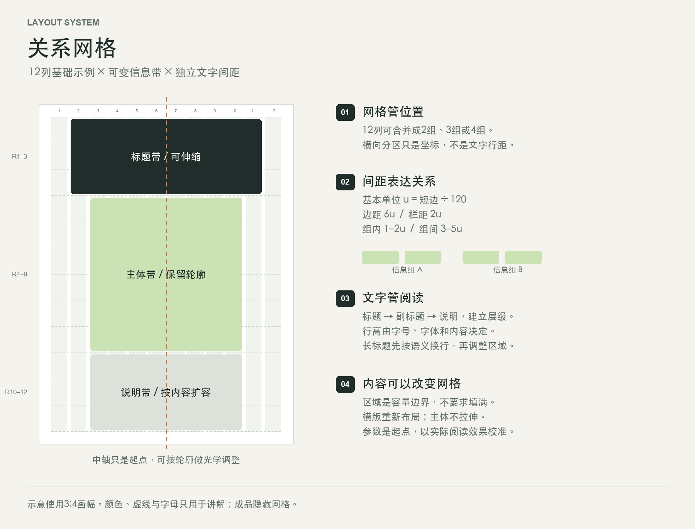
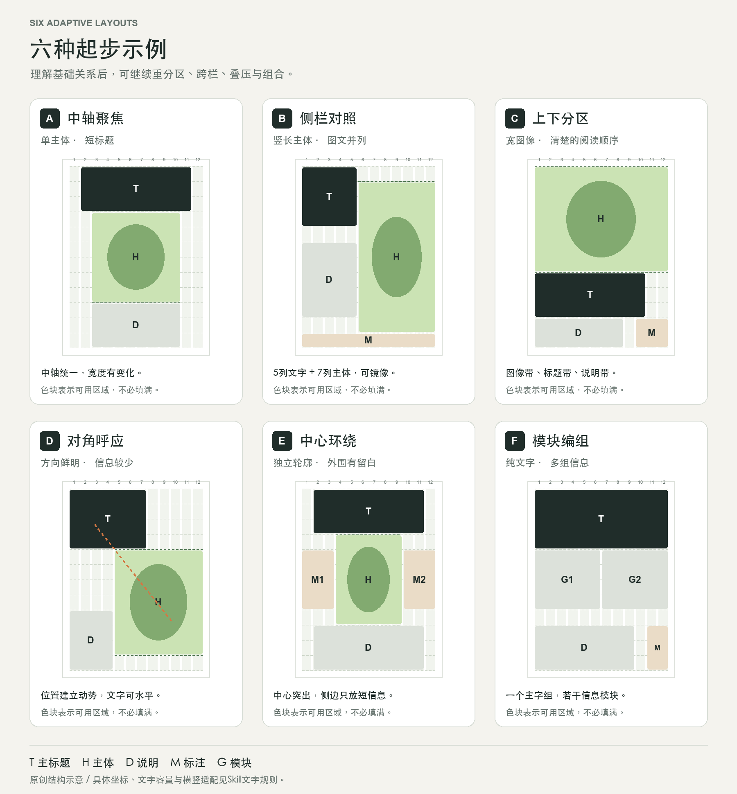
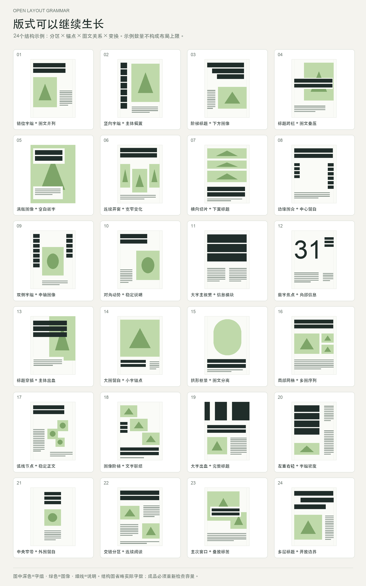

# 排版Skill

使用「关系网格」优化图文关系：保留必要内容，通过布局、比例、对齐、分组和留白建立视觉焦点，再按需要增减细节。这是一个开放的布局生成系统，六种基础布局和图谱中的案例都是例子，不能把它们当作选项全集。原创部分是通用排版原则的组织、组合与执行方式；具体参数是可调整的工作约定。

## 开始时

- 查看原图和实际素材，确认画幅、完整文案、主体轮廓与朝向。没指定尺寸时沿用原图比例；没有原图时，根据用途选取合理尺寸并说明。
- 分清需要原样保留的信息与可调整的视觉元素。品牌名、日期、价格、数字、标志和必要说明不得自行改写或删除；辨认不清的内容先列出，不编造。
- 明确主阅读入口：标题或图像主体。已有明确风格时保留它，优先调整结构；不默认换成黑白、极简或某一种流行风格。

## 选择和执行

1. 判断主要问题：焦点竞争、信息拥挤、分组不清、对齐松散、重心失衡，或阅读中断。只指出影响当前画面的关键问题。
2. 读取 基础网格（见本文对应章节），选择适合信息量的列网格或明确的对齐锚点。12列是方便细分的起点，也可用4列、6列或局部网格；竖向位置刻度不是文字行距。
3. 读取 开放式布局语法（见本文对应章节），从内容生成布局：确定分区、阅读方向、图文关系和关键锚点，再选择有作用的变换进行组合。六种基础示例（见本文对应章节） 可用于理解和起步，不必先选A—F，也不必把新布局归入它们。图像主导、文字主导和多模块内容可以使用不同生成路径。
4. 先安排主标题、主体和说明的关系，再调整字号、对齐、组间距与留白。文字可以成为主视觉，图文可以有目的地叠压、穿插或框景；关键文字保持可读。坐标表示可伸缩区域，不要求用元素填满。文字超出时先扩容或重排，不直接缩成难以阅读的小字。
5. 细节只服务于分组、方向或主题。需要时添加分隔线、编号或小色块；干扰阅读时减少装饰。
6. 使用当前可用的设计工具完成用户要求的图像、可编辑文件或布局说明。工具无法精确遵守坐标时，把网格翻译为相对位置与比例，并检查实际成品。不要把网格线、区域字母、参考图或坐标注释输出到最终海报，除非用户要求展示分析。

## 文字与图片配合

文字是可执行规则，示意图帮助理解空间关系。支持图像查看时，根据需要打开对应图片；仅能处理文字时，依据列号、分区和公式执行即可。Markdown图片链接不代表执行环境一定会自动读取图片。全部文字规则已合并在本文中；不依赖子目录或其他Markdown文件。







## 用户要求裂变或多个方案时

- 保持同一组必要文案、指定主体和画幅，先锁定内容，再改变关系。默认可以改变布局，不默认改写品牌信息、文案或素材身份。
- 用「分区方式、阅读路径、图文关系、主次比例、字组轮廓」描述各方案区别。只有换色、换字体、装饰增减或整张镜像，不能充当结构差异充分的多个方案。
- 给每个候选写一行变换记录，例如「非对称分栏 + 主标题跨栏 + 主体出血」，然后逐个检查容量、阅读、遮挡和重心。相似候选合并，保留用户需要的数量；不把排列组合数量当作有效方案数量。
- 开放组合也需要约束：变换服务于内容与主题，不能把所有操作堆在同一张海报里。用户只要一个成品时，内部选择合适方案即可，不默认增加付费生成数量。

## 必须处理的适配

- **长标题**：按语义换行 → 增加标题区 → 移动其他区域 → 适度缩小字号。不要只为凑轮廓拆散词语。
- **纯文字**：用主字组承担主体功能；保留完整信息的阅读顺序，不凭空生成装饰图片。
- **密集信息**：采用分栏和模块，把同组内容靠近；避免正文绕排、旋转和多处抢焦点。
- **横版或极窄竖版**：重新分配图文区域，保留层级与对齐关系，不直接拉伸竖版坐标。平台按钮、裁切和文字安全区优先于默认边距。
- **光学修正**：先按网格定位，再根据轮廓、朝向、明暗和裁切调整。几何中心是起点，不设固定的「一律上移」比例。

## 交付与检查

用户要成品时交付成品，附一句选择理由；需要布局说明时，给出「骨架、画幅、主要区域、层级、调整原因」。无需每次输出整套理论。

只拿到文字描述、缺少实际素材时，可以先给布局方案和容量估算；标明尚待实际排版检查，不宣称已完成成品或验证了溢出。

至少检查两种观看状态：
- 原尺寸：文案和数字是否准确，边缘、遮挡、行距和实际文本是否溢出。
- 手机缩略图：主入口是否清楚，标题是否可读，分组是否成立；必要说明还应在正常阅读尺寸下清晰可读。
- 跨工具或导出文件：检查最终文件实际使用的字体。替代字体会改变字面、换行和边界，不能仅依据另一个渲染器的测量宣称一致；必要时重新导出，或同时交付可编辑文本版与文字转路径的展示版。

比较前后效果时使用相同文案、素材和画幅，说明哪些是排版调整。未经实际应用验证，不承诺点击率或流量提升。


# 基础网格与文字规则

## 1. 这套系统的工作单位

设画布宽高为 W、H，短边 S=min(W,H)，基本间距单位 u=S/120。

| 参数 | 默认起点 | 用途 |
|---|---|---|
| 左右边距 mx | 6u | 留出稳定内容边界 |
| 上下边距 my | 6u | 保持主要内容与画布边缘的距离 |
| 栏数 N | 默认12，可改为4、6或其他适合内容的数量 | 控制定位粒度，不要求全部显现 |
| 栏距 g | 2u | 区分并列区域 |
| 组内间距 | 1–2u | 标题与副标题、同组说明之间 |
| 组间间距 | 3–5u | 区分不同信息组 |
| 主体周围留白 | 按轮廓和朝向确定 | 强调主体，容纳视觉方向 |

这些数值是关系网格的默认工作约定，不是行业标准或审美合格阈值。可以调整，但同一画面中相同关系应尽量采用同一间距等级。画面内密集不等于不好，关键是疏密有目的、阅读不受阻。

满版背景图可以延伸至边缘；文字、标志、完整产品等关键内容仍需安全边界。用户给定的出血、品牌规范和平台遮挡区优先于默认参数。

## 2. 列网格与锚点：负责横向位置

内容宽 CW=W-2mx，单列宽 c=(CW-(N-1)g)/N。下面用N=12示例，此时 c=(CW-11g)/12。若改变列数，需要重算列宽，不能继续沿用C12区间。

列号记作 C1…C12：

```text
画布边缘 | mx | C1 | g | C2 | g | … | C12 | mx | 画布边缘

3组布局： [ C1—C4 ] [ C5—C8 ] [ C9—C12 ]
2组布局： [     C1—C6      ] [     C7—C12      ]
侧栏布局：[ C1—C5 ] [         C6—C12          ]
```

跨 C_a 到 C_b（两端包含）时：

```text
x = mx + (a-1)*(c+g)
width = (b-a+1)*c + (b-a)*g
```

对齐优先落在列边界或明确的中心轴上。主体可跨列；不需要把轮廓每一处都对齐。字形留边、圆形轮廓可做小幅光学补偿。

复杂版式可用局部网格：先分出大的信息区，再在各区内建立不同列数和对齐关系。曲线、散点或透视结构可改用明确锚点，记录其相对画幅位置、关联元素和阅读顺序；例如主标题沿同一斜向边线，日期与地点仍在稳定的矩形字组中。自由布局需要可解释的关系，不是随机坐标。

## 3. 竖向12分区：负责区域定位

内容高 CH=H-2my，每个参考分区高 r=CH/12，记作 R1…R12。

```text
R1—R3   常可作为标题带
R4—R9   常可作为主体带
R10—R12 常可作为说明带
```

这只是一个示例，图像优先的海报可以把主体放在最上方。分区线用于表达区域位置和占比，可以随内容移动。它们既不是12行字，也不是等高信息卡。

跨 R_a 到 R_b（两端包含）时：

```text
y = my + (a-1)*r
height = (b-a+1)*r
```

相邻区域在分区边界相接时，需要在区域内部留出间距，不能把标题和正文顶到同一条线上。区域是容量边界，实际字组和主体通常小于它。

## 4. 1080 × 1440 的起步例子

```text
W=1080, H=1440, u=9
mx=my=54, g=18
内容区：x=54, y=54, width=972, height=1332
列宽 c=64.5；横向分区高 r=111
```

例如 A 中轴聚焦的标题区 C2—C11 / R1—R3：

```text
x=136.5, y=54, width=807, height=333
```

这些是设计画布坐标。实际使用中保留小数或在最终像素绘制时统一舍入，避免逐列累计误差。不要把例子的像素值直接搬到其他尺寸。

## 5. 文字层级与行距

先区分 T=主标题、S=副标题、D=说明、M=标注，再设字号。下面是1080级海报的起点，不是固定配方：

| 层级 | 起始字号 | 常用行高 | 排版判断 |
|---|---|---|---|
| T 主标题 | 9–15u | 1.05–1.2倍字号 | 先看语义换行与可用宽度 |
| S 副标题 | 5–7u | 1.2–1.4倍字号 | 与主标题成组，区别于正文 |
| D 说明 | 3.5–4.5u | 1.35–1.55倍字号 | 以正常手机观看的可读性验证 |
| M 标注 | 约3u起 | 随字体调整 | 不将关键日期、价格或必要声明降为难读小字 |

字距从字体默认值开始。长中文标题可先尝试2–3行；根据实际内容决定行数，不为满足行数删字。英文、数字、中文的字面和视觉重量不同，不能只用同样字号判断是否等重。

文字行高独立于竖向分区。连续正文若需要基线网格，以它实际使用的行高建立；其他字号不必共享该行高。间距可按u的等级组织，但不强迫每行文字都对齐到u。

### 文字容量怎么检查

先从区域宽高扣除内部留白。中文为主时，可用「有效宽度 ÷ 字号」粗估每行字数，用「有效高度 ÷ 行高」粗估可容纳行数；分段、手动换行、标点禁则和字体字面都会改变结果，英文数字混排不能一律按一个字符一个全角字计算。

粗估后用实际字体、完整原文和真实行距排一次，检查换行、截断与溢出，条件允许时留出少量容量余量。放不下时依次考虑扩大区域、改分栏或上下关系、减少无用装饰和多余空段，再在可读范围内调整字号。日期、地点、必要声明和标志也要分别检查，不能只估算正文。

## 6. 看见网格，但不被网格限制

- 对齐：先共享主要边线，再允许主体有目的地突破边界。
- 平衡：看明暗、面积、轮廓和位置共同形成的视觉重量，不按左右像素数量机械平分。
- 朝向：人物视线或物体运动方向通常需要可供延续的空间；根据叙事决定，不把它当硬性禁忌。
- 对比：用少量强对比建立入口；不要同时把所有字放大、所有色加亮。
- 细节：具有分隔、呼应或说明作用才保留。删去无用细节也是优化。

## 7. 参考与归纳边界

观察依据为用户选定及其相关推荐中的视觉例子：
- [九种海报构图示意](https://www.pinterest.com/pin/229120699786185263/)：观察主体与文字的不同分布。
- [同一文案的不同排版](https://www.pinterest.com/pin/628181848070100285/)：观察字组轮廓、换行、分组和层级。
- [纯文字长条海报与卡券](https://www.pinterest.com/pin/583497695503288456/)：观察数字焦点、疏密和信息块。
- [图文混排海报合集](https://www.pinterest.com/pin/948430002778455959/)：观察主体轮廓、方向与周围文字的关系。

这里的来源标题部分为便于识别的描述，未核定转载图片的原作者。网格参数、组合语法及配套图是本次整理的工作系统，并非原图作者声明的参数。配图为新绘制的结构示意，不复制这些海报的成品图。


# 开放式布局语法

A—F是说明关系的六个例子，不是选择范围。每次从当前内容建立骨架，再组合合适的变换。下面的操作也不是封闭目录；新的关系只要能说明阅读顺序、对齐依据和容量，就可以成立。

## 从内容生成结构

1. **标记角色**：T主标题、S副标题、H图像主体、D说明、M标注。纯文字时T可以兼任H；多图时说明各图是主次、并列还是连续叙事。先确认不可删改的原文与不可遮挡的主体区域。
2. **建立坐标**：以扣除安全边距后的内容区为基准。可用4、6或12列，也可使用明确的左边线、中心轴、图片边界和局部基线。列数按内容粒度选择；非均匀分区写出宽度关系。以百分比描述时，明确坐标基于内容区，左上为0%、右下为100%。
3. **安排容量**：先为长标题、正文、日期和标志预留能实际容纳的区域；区域可以是矩形，也可以是若干连续文字带。图像可满版，必要信息仍在安全区内。
4. **指定阅读方向**：说明先看谁、随后看谁。方向可纵向、横向、对角、围合或曲线；散点需要共同锚点、重复关系或可追踪的次序。把注意力分散到多个点时，仍要让主要信息可辨。
5. **选择图文关系**：分离、并列、嵌入、环绕、叠压或图文互为形状。先选择能服务内容的关系，再调整风格。
6. **施加变换并检查**：从下表选择有理由的操作，逐项检查容量与阅读是否仍成立。操作叠加造成拥挤时撤回次要操作，不靠缩小全部文字解决。

字组结构由换行、方向、行宽、字号比例和疏密决定；字体风格、颜色、纹理属于另一层。同一骨架仅换颜色或字体，不算新的布局变体。

## 可组合的操作

| 操作 | 对象与变化 | 适用与保护条件 |
|---|---|---|
| 分区重组 | 合并、拆分或交换T/H/D区域，改变宽高占比 | 内容多寡或横竖版变化时使用；跨区后保留语义顺序 |
| 镜像换侧 | 翻转区域位置和对齐方向 | 适合主体朝向改变；文字本身、标志和图片不自动镜像 |
| 尺度偏置 | 放大主字组或主体，缩减次要区域 | 形成清楚入口；次要信息保持实际可读，不统一等比例缩放 |
| 字组重排 | 按语义换行，改变行宽、行数与局部字距 | 可形成阶梯、长条或块面；不随意拆词，不漏字，不强行填满形状 |
| 跨栏与错位 | 字组或图像跨过局部分区，沿另一锚线偏移 | 建立联结或节奏；仍保留主要对齐依据，不造成阅读顺序歧义 |
| 裁切与出血 | 图像、色块或装饰字形延伸至画布外 | 强化尺度和空间；保护必要主体，文字裁切需有完整可读版本 |
| 叠压与穿插 | 改变图文前后关系，让局部轮廓穿过字组 | 适合独立轮廓或干净背景；不遮挡关键字、标志、面孔与必要细节 |
| 框景与留中 | 将信息移向边缘，围出空白或图像窗口 | 中心留白需要服务焦点或停顿；正文保持自然方向，不逐字绕边 |
| 切片与开窗 | 将同一图像分为连续窗口，或用几何形遮罩 | 有利于强调局部、分段叙事；保持素材身份，不虚构不同视角 |
| 重复与序列 | 重复字形、图像局部或模块，设置大小和间距节奏 | 适合主题强调或并列内容；不让日期、数量等重复后改变事实含义 |
| 有限旋转 | 旋转短标题、标签、图片或整体局部组 | 方向应服务主体与阅读；正文、必要声明保留易读方向，旋转后复查边界 |
| 曲线路径 | 让图像或短标签沿弧线、波形、轮廓排列 | 明确路径、节点和阅读起点；长正文放入稳定区域，避免随机散落 |

## 组合实例：可以超出六个示例

下列位置仅展示组合方法，需要按实际内容调整，不能再当成固定模板。

**满版嵌入**：H延伸至画布边缘；依据照片已有的干净区域，在内容区x=35%处建立标题左边线，T放于上半部。D在左下窄栏，M沿底边。组合「图文嵌入＋错位锚点＋尺度偏置」，保留照片视觉重点；背景复杂时换位置或增加局部底色。

**空心围合**：先在内容区中部留出一块明确空白，T以完整语义分别形成上方宽字组和一侧短字组，D放在下方稳定区域，另一侧只放短标注。组合「框景留中＋字组重排＋不对称平衡」，中心可以保持空白，不必填入主图。长文案超出边缘容量时扩大稳定文字区。

**连续开窗**：同一主图分成宽窄不同、上下错位的三个窗口，保留可辨的连续关系；T跨过两个窗口之间的空白形成联结，D集中在下方一块区域。组合「切片＋跨栏＋错位」，不把窗口数量当成新素材数量，不让文字压在难辨的纹理上。

**字组成为图像**：没有主图时，将完整标题按语义排成阶梯轮廓，最大的关键词建立入口；副标题沿另一条锚线排列，正文采用稳定的单栏或双栏。可用标题中的装饰性重复副本形成局部出血，完整标题仍保留。组合「字组重排＋尺度偏置＋局部重复」，不依赖新插图补足视觉。

**曲线与稳定文字并置**：多个已有图像或短标签沿一条S形方向排列，大小与间距递变；T固定在起点附近，D放在曲线外侧的清楚文字区。组合「路径＋序列＋分区」，若信息必须逐项阅读，使用原有编号或清楚的连接关系；装饰性路径不必画出来。

## 产出与验证

布局说明至少写清「角色、坐标基准、锚点、区域容量、阅读顺序、选用变换、保护项」。需要多方案时，改变主要阅读入口、图文关系或分区方式中的实质关系，并用同一内容与素材比较；不用配色差异充当结构差异。

最终检查完整文字、数字与标志；用实际字体检查行宽、行高和溢出；检查裁切与遮挡；在缩略图中查看入口和分组。成品隐藏网格和分析标记。若破格以后必须解释很久才能看懂，应先简化关系。

这些操作归纳自用户提供的Pinterest长截图中的字组重排、满版图文、开窗切片、边缘围合、错位与重复等视觉关系。这里只提取结构方法，不将截图中的风格、字体或配色作为强制样式，也不复制具体作品。


# 六种基础示例（不是模板上限）

这些案例仅帮助理解网格区间；实际创作先读取开放式布局语法（见本文对应章节），可以重新分区、组合或从锚点开始，不要求从A—F中选一个。

## 读法

C=列，R=竖向位置分区；区间两端包含。T=主标题字组，H=视觉主体，D=说明，M=辅助标注，G=内容模块。

坐标适合作为方形或常见竖版海报的起点。每个区域都可按内容伸缩；主体区表示可用范围，不表示把素材变形成矩形。区域内允许留白，不能为填满区域而放大无关内容。参见 基础网格（见本文对应章节） 的换算公式。


## A / 中轴聚焦

```text
骨架：共用中轴，宽度有变化。
T 主标题：C2—C11 / R1—R3
H 主体：  C3—C10 / R4—R9
D 说明：  C3—C10 / R10—R12
阅读：T → H → D；图像主导时可降低T的重量。
```

适合单个独立主体、短标题和集中表达。标题与主体沿几何中轴起步，再做光学调整；说明文字可以成组左对齐，避免把多行长正文逐行居中。标题变长时增加标题带，主体可适度下移；说明较多时考虑C或F。

## B / 侧栏对照

```text
骨架：5列文字 / 7列主体，可左右镜像。
T 主标题：C1—C5 / R1—R4
D 说明：  C1—C5 / R6—R10
H 主体：  C6—C12 / R2—R11
M 标注：  C1—C12 / R12
阅读：文字侧与主体形成一组主关系，再看D、M。
```

适合竖长主体、产品或人物与文字并列。主体保持原始比例，朝向可决定左右关系。文字容量不足时改为6/6分栏或上下分区，不能仅缩小正文。宽幅横版可扩大主体侧，按内容分配比例。

## C / 上下分区

```text
骨架：宽图像带 + 标题带 + 说明带。
H 主体：  C1—C12 / R1—R7
T 主标题：C1—C10 / R8—R10
D 说明：  C1—C8 / R11—R12
M 标注：  C10—C12 / R11—R12（可选）
阅读：H → T → D；标题也可移至上方。
```

适合横向场景图、图像叙事、标题后有补充说明的海报。图文共用左边线。说明变多时降低图像带高度、扩大文字区，或切换F；若主体不能裁切则完整容纳并留白，不以拉伸解决。

## D / 对角呼应

```text
骨架：主标题在左上，主体向右下展开，说明占稳定空白。
T 主标题：C1—C7 / R1—R4
H 主体：  C5—C12 / R5—R11
D 说明：  C1—C4 / R9—R12
方向轴：标题区中心 → 主体区中心；可以镜像。
```

适合本身带方向性的主体、动感主题和少量文字。优先用位置和主体朝向建立对角关系，文字可以保持水平。这里的斜线是阅读方向，不是必须添加到成品中的线。需要密集正文、严格顺序或表格信息时优先其他骨架。

## E / 中心环绕

```text
骨架：中心主体 + 上方主标题 + 两侧短信息 + 下方说明。
T 主标题：C2—C11 / R1—R3
H 主体：  C4—C9 / R4—R9
M1 标注： C1—C3 / R5—R8（可选）
M2 标注： C10—C12 / R5—R8（可选）
D 说明：  C2—C11 / R10—R12
阅读：T/H先形成焦点，外围按内容顺序安排。
```

适合轮廓独立、外围有可用空间的主体。两侧只放简短信息，可只使用一侧；不让每个边都同等抢眼。侧面中文短标注可竖排，日期、链接、英文段落和正文保持自然读法。不要把长正文逐字绕成圆。

## F / 模块编组

```text
骨架：一个主要字组 + 2至4个清楚的信息模块。
T 主标题：C1—C12 / R1—R4
G1 模块： C1—C6 / R5—R8
G2 模块： C7—C12 / R5—R8
D 说明：  C1—C9 / R10—R12
M 标注：  C11—C12 / R10—R12（可选）
阅读：T → G1/G2 → D；按语义调整模块顺序。
```

适合纯文字、活动信息、多项内容。G1/G2可以是文字、图片或数字，内容相同级时使用一致的字体与间距。主标题字组可承担主体功能。日期、地点、参与方式等按语义成组，不为对称把一句话拆到两栏。内容较长时改单栏信息带，模块高度按内容分配。

## 横竖适配与破格

- **方形**：保持主要对齐关系，减少纵向空段，重新检查标题与主体的比例。
- **横版**：通常把A/C的上下关系重排为左右关系，或采用B/F；按新画幅计算u与列宽。不要将已有图像和文字横向拉伸。
- **9:16**：按实际发布页面预留顶部、底部与按钮遮挡空间，再把可用内容区重新分成12个位置刻度；不在底部空隙硬塞关键信息。
- **海报过密**：先清理重复视觉元素和不必要空行，在允许范围内重分区；必要内容确实容纳不下时，提出拆页或改变画幅，不擅自删去。
- **有意破格**：允许主体跨列、局部越界或标题突破边线，但必须能说明它如何服务焦点、方向或主题，且不妨碍关键信息。

## 可直接使用的布局描述

需要把方案交给设计工具时，用下面的信息组织指令，数字只在工具支持时输出：

```text
画幅：沿用原图 / 指定W×H。
保留：完整文案、品牌标志、指定主体与原有视觉风格。
主要问题：当前最影响阅读的一至两项。
布局：说明分区、锚点、图文关系及变换组合，与主体形状/信息量的关系；可以引用A—F但不必选择其中之一。
区域：标题、主体、说明的列区间和竖向分区；也可转成相对位置。
层级：第一眼关注什么，次要信息如何降低重量。
适配：长标题、正文、主体裁切和安全区的具体处理。
成品：隐藏网格、区域字母和说明标注；保留需要的设计内容。
检查：原尺寸检查准确性与溢出，缩略图检查主次。
```
